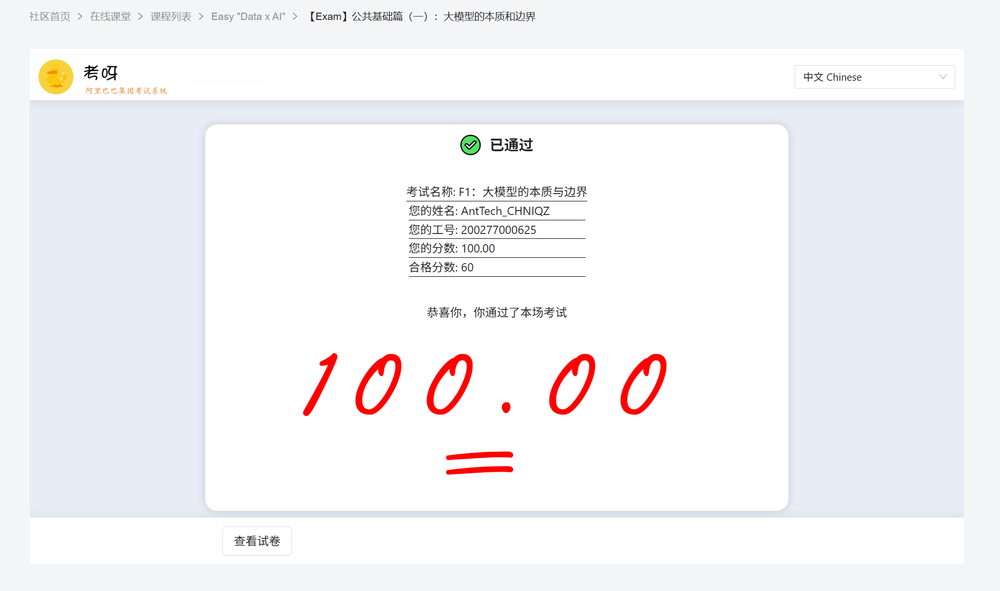
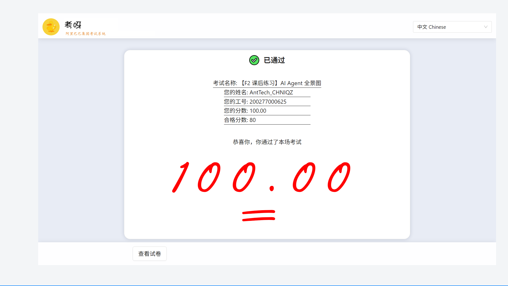

# 第 01 次学习笔记｜从大模型的边界到 AI Agent 的数据系统

> **课程**：Datawhale《Easy Data × AI》
>
> **学习日期**：2026 年 11 月 17 日
>
> **开始时间**：17:58
>
> **学习范围**：F0、F1、F2，共三节
>
> **课程入口**：[Easy Data × AI](https://datawhalechina.github.io/easy-data-x-ai/)

正式开始学习 Datawhale 的 Easy Data × AI 课程！希望能在这样优质的共学环境里，顺利完成学习。

本篇记录课程要点，也保留我此前使用 OpenClaw、ChatGPT 和 Codex 的经历、疑问与感想。原始开篇写的是“F0–F3 三节课”，这里按实际记录的内容统一为 **F0–F2**。

## 目录

- [一、F0：课前闲聊——OpenClaw 为什么越用越好用？](#一f0课前闲聊openclaw-为什么越用越好用)
- [二、F1：大模型的本质与边界](#二f1大模型的本质与边界)
- [三、F2：AI Agent 全景图](#三f2ai-agent-全景图)
- [四、课后练习：画出 Codex 的能力地图](#四课后练习画出-codex-的能力地图)
- [五、课后感想：重新理解当初折腾 OpenClaw 的经历](#五课后感想重新理解当初折腾-openclaw-的经历)
- [六、后续学习清单](#六后续学习清单)
- [七、课后测验与成绩截图](#七课后测验与成绩截图)

## 一、F0：课前闲聊——OpenClaw 为什么越用越好用？

### 1. 三种常见的错误使用姿势

| 错误姿势 | 我的理解 |
| --- | --- |
| 把 Agent 当通才 | 就像人一样，没有专业知识积累，即使很聪明，也很难直接解决专业问题。 |
| 没有培训就开箱即用，期望过高 | 即使是专才，也需要“入职培训”，才能适配具体业务和实际工作流。 |
| 模型没选对，底层能力不足 | 模型能力参差不齐，不能期待它稳定完成超出自身能力范围的工作。 |

### 2. 核心认识：一个自我进化的数据系统

课程对 OpenClaw 的核心概括是：**一个自我进化的数据系统。**

我的理解是，要在持续使用中与 Agent 一起沉淀习惯、规则和工作流，让它逐渐积累自己的私域数据，成为真正理解我的 Agent。

这里的“进化”，重点是数据、记忆和工作流程的积累与更新，不必理解为每次对话都在重新训练底层模型。

### 3. 七个核心骨架

重点不是记住文件名，而是理解它们分别承担什么功能。

| 文件或目录 | 承担的功能 |
| --- | --- |
| `SOUL.md` | Agent 的人格与行为风格 |
| `USER.md` | 用户画像 |
| `AGENTS.md` | 工作规范与踩坑记录 |
| `TOOLS.md` | 环境与工具备忘 |
| `SKILL.md` | 具体技能的操作手册 |
| `memory/*.md` | 日常记忆 |
| `MEMORY.md` | 提炼后的长期记忆 |

**一定要做好 workspace 的备份。** 与 Agent 共同积累的工作方式、用户偏好和经验，都可能沉淀在这里。

### 4. 我的实践经历与疑问

最初部署 OpenClaw 时，我尝试安装过帖子推荐的 memos 插件，是一个在线记忆系统。但实际体验不太理想：很多事情依然不能准确回忆，没有达到我在 ChatGPT 中感受到的效果。

**目前还没搞清楚问题出在哪里。** 后续需要从记忆是否写入、提炼是否准确、召回是否成功等环节继续排查。

### 本节重点

> OpenClaw 的代码框架决定了它能做什么，数据决定了它做得多好。而这些数据，是我和 Agent 在一次次对话、任务和复盘中共同积累出来的。

## 二、F1：大模型的本质与边界

### 1. 一个基础认知

课程用下面这个公式强调数据与模型的关系：

**AI 产品的能力上限 = 数据质量 × 模型能力。**

这是一个帮助理解的概念公式。它提醒我：模型能力很重要，但输入数据的质量同样会直接影响结果。

### 2. 大模型为什么会“说谎”？

大语言模型生成文本的基础机制是**预测下一个 token**，并不天然等同于从事实数据库中查找经过验证的答案。

我的初步理解是：模型从训练数据中学习了大量表达方式和关联，但“说得像真的”并不代表“已经核实”。相关知识缺失、知识不准确，或者生成过程出错，都可能导致幻觉。

#### 我第一次遇到幻觉的经历

第一次使用 GPT 时，还是 GPT-3.5。我问它能不能写歌，它说没问题，随后声称已经写好，并给了一个 MP3 下载链接。

结果链接根本无法下载。提醒它之后，它仍然没有意识到自己在当时的对话环境中并没有生成、上传文件的能力，反而认为是“上传出错”，继续编造不存在的链接。

当时只觉得大模型有些笨，并不明白原因。现在回头看，这就是一次很直观的幻觉体验。

### 3. 三类局限与对应的数据补充方式

| 局限 | 问题表现 | 数据层面的应对思路 |
| --- | --- | --- |
| 幻觉 | 生成貌似合理但不真实的内容 | 提供可检索、可验证的事实材料，并核对回答是否有依据。 |
| 知识截止 | 无法仅凭训练知识获知最新信息 | 接入搜索、API 等可更新的数据源。 |
| 个性化盲区 | 不知道我的偏好、私域资料与业务规则 | 提供相关上下文，或建立经过授权的用户、业务数据访问与记忆机制。 |

关于知识截止，我理解到：与其把所有新信息反复训练进模型，不如让模型在需要时检索最新知识，这在很多场景下更经济、灵活。

个性化盲区也很好理解：模型的通用知识再丰富，我的私域数据也不可能凭空出现在它的上下文里。需要主动提供数据、授权访问，或采用合适的知识注入方式。

课程把这三类局限概括为：**“它只有训练数据，没有你的数据。”** 这句话帮助我把注意力转向数据层。

> **概念补充**：这是一种教学上的概括，不代表幻觉都由缺少私域数据引起。即使提供了材料，模型仍可能检索失败、误读内容或推理出错；补数据能改善表现，但不能保证消除幻觉。

### 4. 放到 Agent 系统中，可以怎样应对？

- **缺少事实依据**：通过 RAG，把知识库、文档、SOP 中的相关内容检索出来，放入上下文。
- **缺少最新信息**：通过 API、Webhook、流式更新等机制，让系统获得最新事件，并在需要时提供给模型。
- **缺少用户与业务背景**：构建数据记忆层，积累用户画像、偏好、历史对话和业务规则。

我的概括是：**让模型具备获取自身训练知识之外的数据、理解这些数据并正确使用它们的能力。**

### 5. 一个还没有答案的问题

如果趋势是让模型越来越善于获取外部数据，那么未来是否不必一味追求更大的模型？

只要模型足够聪明，能获取数据、作出判断、正确反馈，是否就不需要把所有知识都记在参数里？比如，它是否一定要预先知道“肖邦是谁”？能否因此让模型更精简，降低本地部署的要求？

**这是我当晚提出的疑问，暂时没有结论，留待后续学习和实践。**

### 6. 当 AI 不好用时，先问三个问题

1. **它缺的是哪种数据？** 是可验证的事实、最新信息，还是用户与业务背景？
2. **问题主要在模型层，还是数据层？** 可以在尽量保持任务和上下文一致的情况下比较不同模型，帮助判断原因；更换模型的表现差异只是排查线索。
3. **数据能补吗？** 数据是否存在？如果存在，模型能否访问和检索到？如果不存在，又该如何构建？

### 本节重点

> 这个能力的数据需求是什么？数据从哪来、怎么存、怎么检索？数据层的设计决策如何影响 AI 的最终效果？

遇到问题时，不要只想到换模型。很多时候，补充和组织好数据，才是更有效的解题方向。

## 三、F2：AI Agent 全景图

### 1. 从对话助手到 Agent

课程把上一节的概念公式进一步扩展为：

**AI Agent 的能力上限 = 模型能力 × 数据质量 + 流程编排。**

我特别注意到流程编排前是**加号**。我的理解是，除了模型和数据，还需要关注如何组织任务、安排步骤、协调工具。这仍然是便于理解的概念表达，不是可直接计算的性能公式。

在基础的单次问答模式中，AI 主要负责分析问题、给出建议。Agent 则进一步把模型接入工具、数据源和执行流程，让系统能够行动，并根据结果继续调整。

它的本质可以概括为：

**感知 → 推理 → 行动 → 观察 → 继续推理。**

这是循环迭代的过程。

### 2. 四个核心组件

| 组件 | 功能 |
| --- | --- |
| Memory（记忆系统） | 存储与召回历史交互、经验和用户偏好。 |
| LLM（大语言模型） | 作为核心“大脑”，负责推理与决策。 |
| Planning（规划能力） | 拆解任务，制定执行策略。 |
| Tool Use（工具调用） | 连接外部数据源与执行能力。 |

### 3. ReAct 与流程编排

**ReAct = Reasoning + Acting，即推理与行动相结合。** 系统根据当前信息决定下一步行动，观察结果，再继续推理。

今天终于明白了经常见到的 ReAct 是什么意思，学习真好啊！

| 架构思路 | 我的理解 |
| --- | --- |
| ReAct | 根据观察结果动态选择下一步，形成推理与行动的循环。 |
| Workflow（流程编排） | 按预先定义的步骤、顺序和条件组织工作。 |

课程用“ReAct 约占 80%–90%、自定义工作流约占 10%–20%”来说明其普遍程度。我先记录这个课程说法；**本笔记未核实该比例的统计来源，不把它作为已验证的行业数据。** 实际系统也可以结合两种思路。

### 4. LLM 与 Data 的协同

课程强调：

> 模型决定 Agent 能“想多好”，数据决定 Agent 能“做多好”。

经典原则是 **Garbage In, Garbage Out——垃圾进，垃圾出。**

这在很多行业都适用，比如音频制作领域。源头质量不好，后面的处理再复杂，也很难凭空得到理想结果。

写提示词也是一样。既然希望 AI 解决问题，就应该尽量提供清楚的目标与上下文。想到一个笑话：只说“教我一个月内发财”，AI 给了一大堆建议，使用者再回一句“就这？”——需求本身没有讲清楚，又怎能指望结果足够具体？

### 5. Agent 的四类能力来源

| 能力 | 解决什么问题 | 数据视角 |
| --- | --- | --- |
| RAG | 检索外部知识 | 知识数据的检索与利用。 |
| Memory | 记住用户、经验与偏好 | 个性化数据的积累、提炼与召回。 |
| Skill | 按结构化经验执行任务 | 经验数据的结构化与复用。 |
| MCP | 以统一协议接入外部工具与资源 | 数据与工具接入的标准化。 |

#### 5.1 RAG：让 Agent 会查资料

RAG 的核心是检索与当前问题相关的外部知识，再把检索结果提供给模型生成回答。

| 类型 | 特点 |
| --- | --- |
| Naive RAG（朴素 RAG） | 通常采用“检索 → 拼接 → 生成”的固定流程，进行单次检索，难以主动调整策略。 |
| Agentic RAG | 由 Agent 主动判断，支持多轮检索、改写查询和调整策略。 |

> 这里的“单次检索”不是“单词检索”；朴素 RAG 也不等于只能做关键词搜索。

RAG 的效果与以下因素密切相关：

- **知识库质量**：文档是否完整、准确，更新是否及时。
- **切分策略**：Chunk Size 如何设置，是否需要重叠。
- **检索策略**：采用纯向量检索，还是混合检索。
- **Embedding 模型**：是否适合当前的数据和任务。

这些概念需要继续深入学习。

#### 5.2 MCP：AI 工具生态的“USB 接口”

MCP 通过统一协议，帮助 Agent 接入外部工具与资源。

- 工具侧：实现 MCP Server。
- Agent 侧：通过 MCP Client 连接。

课程介绍的三类能力是：

| 能力 | 作用 |
| --- | --- |
| Tools（工具） | 执行操作。 |
| Resources（资源） | 提供可读取的数据与上下文。 |
| Prompts（提示模板） | 提供预设的交互模板。 |

我的理解：MCP 解决的是工具与资源如何互联互通的问题。接入协议统一了，并不意味着每个工具的质量和能力都一样。

**MCP 需要继续深入学习，它是 Agent 连接外部系统的重要基础设施之一。**

#### 5.3 Skill：把专业经验变成可执行的操作手册

Skill 的本质，是把人类的专业经验转化成 Agent 可以理解、执行和复用的结构化内容。

组成要素包括：

- **操作流程**：一步一步应该怎么做。
- **领域规则**：约束条件与质量标准。
- **成功案例**：优秀输出的参考。
- **术语表**：领域特定词汇。

它与程序性记忆的关系，可以理解为：把“遇到什么情况该怎么做”的经验提前总结、外部化，并做成可重复调用的技能。

用一句带点玩笑的话来说：“你不干，有的是 AI 干！按这个 Skill 来！”不过，**流程更一致，不代表不同模型、不同上下文生成的结果一定完全相同。**

Skill 的效果取决于：

1. **结构化程度**：指令是否清晰、可执行。
2. **发现能力**：能否从技能库中找到适合当前任务的 Skill。
3. **复用性**：能否适用于不同场景与用户。

我的观察是，一些 Agent 已经可以协助把对话中的流程总结成 Skill。但仍需要自己打开文档，看看最终写成了什么，是否完整、准确、适用。

#### 5.4 Memory：个性化数据的积累、提炼与召回

我想，Memory 是否也可以理解为“个性化数据的提炼与召回”？对话存下来了，不代表它已经变成有用的记忆。

课程引用了 CoALA 记忆框架。整理时需要区分以下概念：

| 类型 | 记住什么 | 示例 |
| --- | --- | --- |
| 语义记忆（Semantic Memory） | 事实、知识与偏好。 | “用户是 Python 开发者”“用户偏好简洁回答”。 |
| 情景记忆（Episodic Memory） | 过去发生的事件与经验。 | “上次用 Docker 方案解决了部署问题”。 |
| 程序性记忆（Procedural Memory） | 如何行动的规则与方法。 | “遇到代码问题，先查文档再写代码”。 |
| 工作记忆（Working Memory） | 当前任务中正在使用、处理的信息。 | 当前目标、相关上下文、刚得到的工具结果。 |

> **概念补充**：课程原文把“工作记忆 / 程序性记忆”并列在一项中，容易让人误以为二者是同义词。CoALA 区分工作记忆与长期记忆，并将长期记忆分为情景、语义、程序性记忆。这里单独列出，便于后续复习。[论文入口](https://arxiv.org/abs/2309.02427)

Memory 的效果，我最关注三个方面：

1. **记忆提炼质量**：如何从对话里抽取真正重要的信息。早期 ChatGPT 提炼进记忆的内容曾让我很不满意，重要对话一经简化，意思就变了。
2. **召回策略**：何时调用哪些记忆。既要找对，也要考虑上下文与 token 成本。
3. **遗忘机制**：如何降低过时信息的权重，避免旧信息持续干扰当前任务。

期待后续学习如何设计好这三点。我认为，记忆系统是 Agent 能否与个人建立良好协作体验的关键之一。

### 6. 用数据视角理解这些概念

- RAG 好不好用？看知识库质量和检索策略。
- MCP 能否顺畅接入工具？看协议实现和接口能力。
- Skill 能否复用？看经验是否被清楚地结构化，以及是否能被正确发现。
- Memory 准不准？看信息提炼质量、召回策略和更新机制。

课程给我的启发是：这些看似眼花缭乱的概念，都可以从数据的存储、检索和流转角度去理解。当然，实际效果还受模型、工具和执行流程影响。

以后遇到新的 buzzword，可以先问自己：

> **它在数据层面解决的是什么问题？**

## 四、课后练习：画出 Codex 的能力地图

### 练习要求

选择一个正在使用的 AI 工具，梳理：

1. 有 RAG 吗？能查询外部知识吗？知识从哪里来？
2. 有记忆吗？能记住用户偏好吗？记忆存在哪里？
3. 有 Skill 吗？能调用预定义技能吗？技能如何管理？
4. 有 MCP 吗？能连接外部工具吗？通过什么协议？

然后检查缺失能力的根源：**数据不存在、数据存在但检索不到，还是数据格式不合适？**

### 我的初步回答

我选择的工具是目前正在使用的 **Codex**。

以下是当晚基于个人使用经验的初步观察，**不是对产品内部实现的完整验证**；功能入口也可能随版本变化。

| 能力 | 当晚的观察 | 还需要确认的地方 |
| --- | --- | --- |
| RAG / 外部知识 | 可以查询外部知识，使用体验像是调用了 OpenAI 的外部搜索。 | 外部搜索不等于已经验证内部采用了哪种 RAG 架构，具体实现暂不确定。 |
| Memory | 使用中能感受到记忆能力，也注意到设置里有相关开关。 | 当晚没有仔细查看记忆的实际存储位置、提炼方式和召回机制。 |
| Skill | 在当前使用的界面中，可通过插件、技能相关入口查看，也可输入 `$` 调出技能列表；可以让 Agent 协助修改。 | 需要进一步了解技能的存储、发现与管理方式。 |
| MCP | 可以配置、连接 MCP 服务。 | 具体插件是否通过 MCP 接入，需要逐个确认，不能把所有插件都等同于 MCP。 |

这次练习让我意识到，**“能用这个功能”和“知道它背后的数据与执行链路”之间，还有距离。**

## 五、课后感想：重新理解当初折腾 OpenClaw 的经历

### 1. 学习不会因为工具更新而过时

回顾 OpenClaw，居然觉得好像已经过去很久，似乎都快被大家遗忘了；但按我当时的感受，其实也只是半年多，不免感慨技术变化之快。

不过，技术的发展都有迹可循。学习这门课程，并不意味着只是在学习过去的东西。在我的了解中，OpenClaw 仍然是一些私有化部署 Agent 场景会考虑的方案之一。这段时间里，又有多少人真正吃透了它和业务之间的搭建逻辑，成功完成了业务的 Agent 化？

工具可以替换，重要的是：**如何围绕完整业务逻辑，选择和组织合适的工具，真正把流程跑通。** 所以，相关知识的学习永远不会晚。认真学习吧！

### 2. 当初遇到的资料采集问题

OpenClaw 刚火的时候，我也在折腾，尝试用它采集外网资料。

结果要么资料杂乱无章，要么格式不统一。当时已经意识到必须做好规则约束；对照课程来看，这正符合“没有培训 Agent 就期待它直接上岗”的问题。

不能只告诉它“帮我采集资料”，还要说明什么资料有用、来源如何筛选、格式如何统一、结果如何验收。

### 3. 模型能力不足带来的执行问题

当时使用的是 Qwen 系列模型，具体配置这里没有记录。我个人的体验是，工具调用成功率不高，经常无法返回合适的结果，需要不断人工介入。**这只是当时特定环境下的使用体验，不能直接推广到所有 Qwen 模型或版本。**

例如，让它通过 SSH 连接另一台云服务器，再部署一套 OpenClaw，就没有一次顺利完成。中间出现过：

- 配置密钥登录时，过早关闭原有登录方式，导致无法再次连接。
- 部署过程中，对沟通信道的建立方式产生误解。

也许换一个能力更强的模型能够改善，但这还只是我的猜测，没有做过对照验证。流程约束、环境信息和阶段性检查，同样值得排查。

这也让我理解到，缺少相关知识储备时，用户为什么容易在最初调试阶段卡住：出了问题，既不知道如何判断原因，也不知道该怎样接手。

### 4. 今晚最大的变化

以前遇到 Agent 不好用，我容易先想到“模型不够聪明”。

通过今晚的学习，我开始学着多问一步：**究竟缺少了什么数据，才让 Agent 无法把事情做好？又该怎样设计数据层和执行流程，让它在合适的时候使用合适的信息？**

当时玩 OpenClaw，唯一没有实践成功的是多 Agent。一个原因是，我还没建立起“用多 Agent 解决什么具体问题、怎样分工协作”的逻辑。希望通过这次学习，重新把这些问题梳理清楚。

## 六、后续学习清单

- [ ] 深入理解 RAG 的切分、Embedding、向量检索与混合检索。
- [ ] 学习 MCP 的客户端、服务端，以及工具、资源、提示模板的具体机制。
- [ ] 设计并检查一个可执行、可复用的 Skill。
- [ ] 深入学习记忆提炼、召回策略和遗忘机制。
- [ ] 排查此前 OpenClaw 在线记忆插件效果不佳的原因。
- [ ] 进一步核实 Codex 的记忆存储与能力接入方式。
- [ ] 用一个具体任务梳理多 Agent 的分工与协作逻辑。
- [ ] 继续思考：更强的检索与工具能力，能否降低部分场景对模型规模的要求？

## 七、课后测验与成绩截图

本次提供的两张测验截图，成绩如下：

| 测验 | 得分 | 合格分数 | 结果 |
| --- | --- | --- | --- |
| F1：大模型的本质与边界 | 100.00 | 60 | 已通过 |
| F2：AI Agent 全景图 | 100.00 | 80 | 已通过 |

### F1：大模型的本质与边界

### F2：AI Agent 全景图

